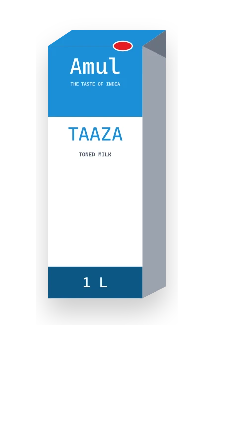
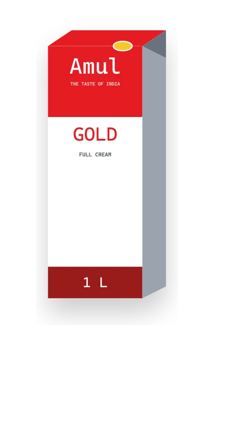
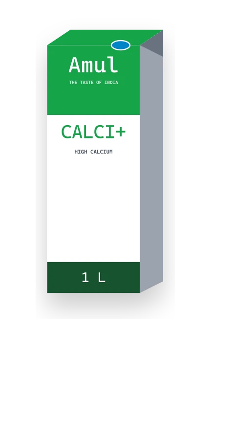
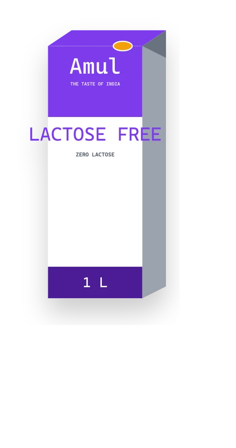

# 🥛 Amul Milk — Pour. Sip. Smile.
### *The Taste of India — Interactive Digital Experience*

<p align="center">
  
</p>

<p align="center">
  <strong>An immersive, ultra-responsive web experience celebrating India's beloved dairy cooperative.</strong><br>
  Featuring real-time 2D fluid dynamics, responsive physics-based milk pouring, animated mascot systems, and scrollytelling.
</p>

<p align="center">
  <a href="#-key-features">Key Features</a> •
  <a href="#-interactive-animations--motion-design">Animations & Motion</a> •
  <a href="#-product-showcase">Products</a> •
  <a href="#-tech-stack--architecture">Architecture</a> •
  <a href="#-quick-start">Quick Start</a> •
  <a href="#-credits">Credits</a>
</p>

<p align="center">
  
  
  
  
  
</p>

---

## ✨ Key Features

- 🌊 **Real-Time Fluid Simulation Engine**: Custom HTML5 Canvas 2D fluid dynamics calculating Bezier stream curves, milk velocity, surface slosh, rising liquid levels, bubbles, and splash ripples.
- 👧 **Living Amul Girl Mascot System**: Highly detailed, authentic vector character with expressive moving animations across six distinct interactive poses.
- 📦 **3D Isometric Product Packaging**: Interactive exploration of Amul Taaza, Amul Gold, Amul Calci+, and Amul Lactose Free with nutrition facts and packaging swatches.
- 🌾 **Farm-to-Table Scrollytelling**: A seven-stage narrative journey tracing milk from rural Anand, Gujarat sunrise collections to morning family breakfast tables.
- ⚡ **Zero-Lag 60 FPS Performance**: Hardware-accelerated CSS animations, memoized component trees, and zero heavy 3D engine overhead.
- ♿ **Inclusive & Accessible Design**: Full keyboard navigation, screen-reader landmark labeling, and reduced-motion preference awareness.

---

## 🎨 Interactive Animations & Motion Design

### 1. Hero Pour Scene
```
Carton Spout (1094, 880) ──> Bezier Curve Stream ──> Glass Landing (391, 277)
                                                           │
                                             ┌─────────────┴─────────────┐
                                             ▼                           ▼
                                      Surface Slosh               Rising Foam
```
- **Dynamic Milk Stream**: Realistic flow that reacts to carton rotation, with fluid tapering, droplet detachment, and slosh physics.
- **Wiping Transition**: Fluid milk wipe transitioning from poster mode into live interactive canvas.
- **User Playback Controls**: Real-time Play, Pause, and Replay capabilities.

### 2. Animated Amul Girl System
The iconic Amul mascot comes alive across the journey with bespoke keyframe animations:

| Pose | Page Section | Animation & Personality |
|:---|:---|:---|
| **`peek`** | **Hero Counter** | Bobs up curiously from behind the counter, looking left & right at the pouring stream with natural eye blinking and ponytail bounce. |
| **`sit`** | **Brand Marquee** | Sits on top of the scrolling ticker strip, swinging her legs in alternating pendulum arcs while sipping milk with a straw. Pauses in sync with the marquee. |
| **`point`** | **Product Shelf** | Dynamically tracks hovered or focused milk cartons, pulsating her pointing finger towards the pack while bouncing with excitement on her toes. |
| **`chef`** | **Amul Gold Reveal** | Sports a jiggling white chef toque, stirring a golden bowl with a golden whisk while magical golden star sparkles (`✦`) float upward. |
| **`wave`** | **Final Call-to-Action** | Enthusiastically waves her hand back and forth in a warm, friendly farewell greeting with smiling eyes and body sway. |
| **`tray`** | **Story Sequence** | Balances a silver tray loaded with fresh glasses of milk with a rhythmic walking cadence. |

---

## 🥛 Product Showcase

<table>
  <tr>
    <td align="center" width="25%">
      <br>
      <strong>Amul Taaza</strong><br>
      <em>Homogenised Toned Milk</em><br>
      Fat: 3.0% · SNF: 8.5%
    </td>
    <td align="center" width="25%">
      <br>
      <strong>Amul Gold</strong><br>
      <em>Standardised Full Cream</em><br>
      Fat: 4.5% · SNF: 8.5%
    </td>
    <td align="center" width="25%">
      <br>
      <strong>Amul Calci+</strong><br>
      <em>High Calcium Enriched</em><br>
      Calcium: 150 mg / 100 mL
    </td>
    <td align="center" width="25%">
      <br>
      <strong>Amul Lactose Free</strong><br>
      <em>Easy to Digest</em><br>
      Lactose: &lt; 0.01%
    </td>
  </tr>
</table>

---

## 🏗️ Tech Stack & Architecture

```
amul-milk-website/
├── public/assets/          # Optimized WebP assets & vector branding
│   ├── brand/              # Official Amul vector wordmark
│   ├── fx/                 # Milk drip transition edges
│   ├── gold/               # Gold reveal backdrops
│   ├── hero/               # Counter backgrounds & physics layers
│   ├── moments/            # Everyday breakfast, coffee & dessert scenes
│   ├── products/           # Responsive 480w & 900w product packaging
│   └── story/              # 7-stage farm-to-table narrative scenes
├── src/
│   ├── components/         # Modular Presentation Layer
│   │   ├── AmulGirl.tsx    # Vector character mascot engine
│   │   ├── AmulPackVector  # 3D isometric carton renderer
│   │   ├── HeroPourScene   # Real-time pouring canvas
│   │   ├── ProductGrid     # Interactive product cards & detail modal
│   │   └── story/          # Scrollytelling views
│   ├── data/               # Product facts, nutritional specs & storylines
│   ├── motion/             # Physics controllers, Bezier maths & clock drivers
│   └── styles/             # Centralized design tokens & keyframes
└── scripts/                # High-res asset generation pipeline (Sharp)
```

---

## 🚀 Quick Start

### Prerequisites
- **Node.js**: v18.0.0 or higher
- **npm**: v9.0.0 or higher

### Installation
```bash
# Clone the repository
git clone https://github.com/SHARABUMANOJKUMAR/Amul-Milk-Website.git

# Navigate into project folder
cd Amul-Milk-Website

# Install dependencies
npm install
```

### Running Locally
```bash
# Start Vite development server
npm run dev
```
Open **[http://localhost:5173](http://localhost:5173)** in your browser.

### Production Build & Typecheck
```bash
npm run build
npm run preview
```

---

## 👨‍💻 Developed By

<p align="center">
  <strong>Shaivika, IIT Technologies</strong>
</p>

<p align="center">
  <em>Crafted with precision, passion, and pride for the iconic Taste of India.</em>
</p>
